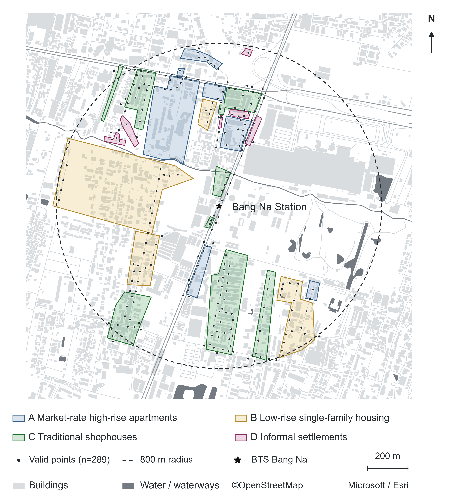
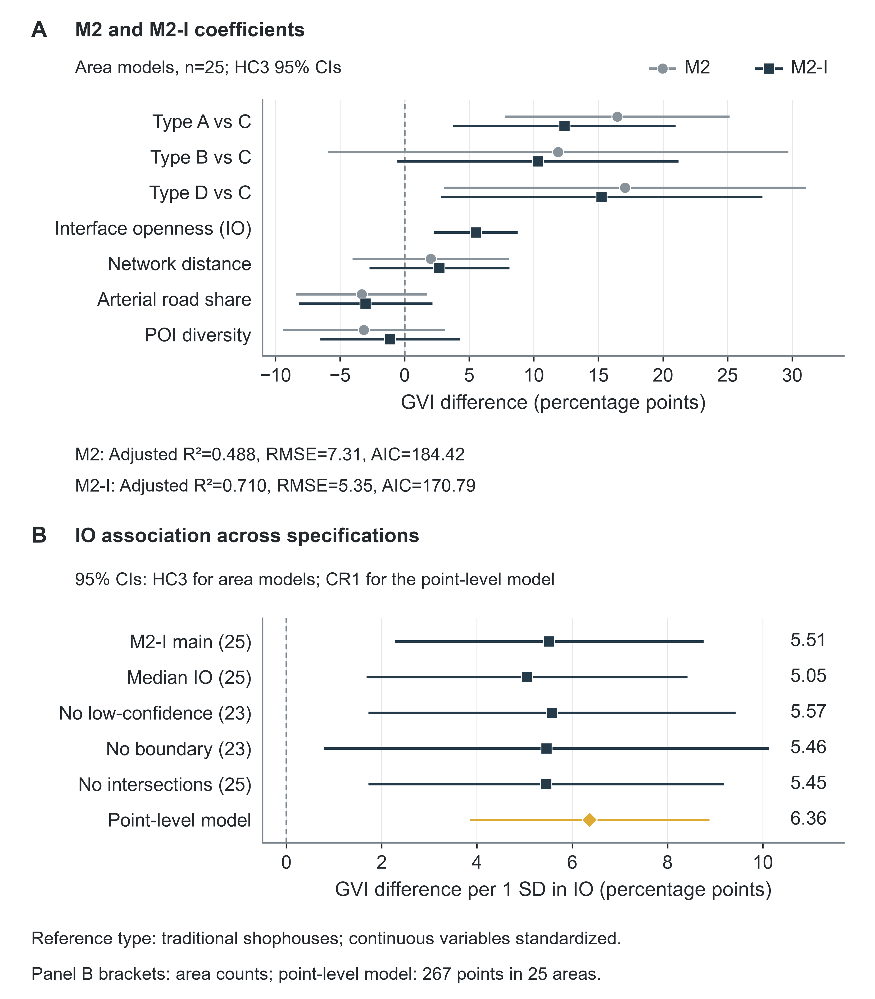

# Street interfaces and urban greenery

Point-to-area analysis of residential types, street interfaces and visible
greenery in Bang Na, Bangkok.

**Python · Spatial metrics · HC3 regression · Sensitivity analysis**

[Methods](docs/IMPLEMENTATION.md) · [Reproduce](docs/REPRODUCING.md) · [Data](data/README.md) · [Citation](CITATION.cff)

## Research question and result

How do residential types and the interface between buildings and public streets
relate to visible greenery in a peripheral transit-oriented development station area?

**Result:** Across 25 residential areas, adding interface openness increases adjusted R² from **0.488 to 0.710**. The included runner reproduces the main models, sensitivity analyses and clustered point model.

<a href="assets/study-area-figure02.png"></a>

**Manuscript Figure 2 — residential types and sampling locations.** Colours
distinguish the four residential types; dots mark valid GVI points. The dashed
800 m circle defines the polygon-selection criterion, not a walking catchment.
Original map credits are retained: © OpenStreetMap; Microsoft / Esri.

| Model | Adjusted R² |
| --- | ---: |
| Residential types + three spatial controls (M2) | 0.488 |
| M2 + interface openness (M2-I) | 0.710 |

In M2-I, one SD higher interface openness is associated with **5.51 percentage
points higher GVI** (HC3 95% CI 2.27–8.75; 25 areas). The controls are mean
network distance to the BTS station, major-road share and mean POI Shannon
diversity in 400 m buffers.

<a href="assets/model-results-figure05.png"></a>

**Manuscript Figure 5 — model comparison and robustness.** Panel A compares
coefficients before and after adding interface openness. Panel B shows its
association across alternative specifications, with HC3 intervals for area
models and CR1 intervals for the point-level model. Both figures are unchanged
from the English v4 manuscript dated 22 October 2026. Open either image for
the full-resolution figure.

## Computational workflow

`Point scores and area variables → aggregation → regression and sensitivity → verified tables`

| Computation | Input | Implementation | Verification |
| --- | --- | --- | --- |
| Interface index and area aggregation | [289 points, 25 areas](data/README.md); 267 valid interfaces | [Interface analysis](src/interface_analysis.py) | Score arithmetic and sample counts |
| Main models and uncertainty | Aggregated interface scores and controls | [OLS and HC3](src/regression.py) | Archived fit statistics and coefficient intervals |
| Seven sensitivity models and clustered point model | Alternative sample and aggregation rules | [Model workflow](src/interface_analysis.py) | Six archived result tables across the full analysis |
| GVI, street context and POI diversity | External images, networks and POIs | [Segmentation metrics](src/segmentation_metrics.py) · [network metrics](src/network_metrics.py) · [POI diversity](src/poi_diversity.py) | Analytical kernel checks |

The numerical runner uses bundled tables. Original inference and GIS scripts
remain in [legacy/](legacy/README.md); those workflows require external inputs.
[Implementation details](docs/IMPLEMENTATION.md).

## Quick start

Run from the repository root with Python 3.12:

```sh
python -m pip install -r requirements.txt
python run_analysis.py --output outputs/reproduction
```

The command writes result tables and `verification.json` to a **new** directory.
Use another directory name for a later run.
[Outputs, tests and reproduction scope](docs/REPRODUCING.md).

## Repository guide

| Location | Responsibility |
| --- | --- |
| [run_analysis.py](run_analysis.py) | Run the numerical analysis and compare with archived results |
| [src/](src/) | Reusable research computations |
| [data/](data/README.md) | Included inputs, units, identifiers and availability |
| [reference/](reference/) | Archived comparison targets, read after estimation |
| [assets/](assets/) | Original manuscript figures used in this README |
| [docs/](docs/) | Methods, reproduction and research record |
| [tests/](tests/) · [examples/](examples/README.md) | Analytical checks and a compact starting example |
| [PROVENANCE.md](PROVENANCE.md) · [source_manifest.json](source_manifest.json) | Source history and machine-readable identities |

Generated files belong in `outputs/`, which is ignored by Git.

## Validation and scope

The full run compares all numerical fields in six archived tables
(`rtol=1e-8, atol=1e-9`): the two main models, seven sensitivity models and
the area-clustered point model. Five analytical tests cover image class
fractions, aggregation, HC3 inference, network geometry and POI diversity.

The manuscript images in `assets/` are original research figures. The public
runner verifies numerical results; it does not regenerate those figure files.
[Validation details](docs/REPRODUCING.md#validation).

## Research record

The model describes conditional associations. Equal-area and point-weighted
summaries answer different questions. The sample uses an 800 m Euclidean station
buffer to select intersecting residential polygons; it is not an 800 m walking
catchment. Unlike Beijing, the main Bang Na GVI includes vegetation only.

**Tools:** Python, NumPy, pandas, SciPy, NetworkX, GluonCV/MXNet, Matplotlib.

**Manuscript authors:** Zihao Lin and Lei Shao.

**Manuscript:** *Residential types, street interfaces and variation in the green
view index along public streets in a peripheral TOD station area: Bang Na, Bangkok*.

[Authorship and research notes](docs/RESEARCH_RECORD.md)

[Repository citation](CITATION.cff) records the code package; manuscript authorship
and figure credits are retained in the [research record](docs/RESEARCH_RECORD.md).
